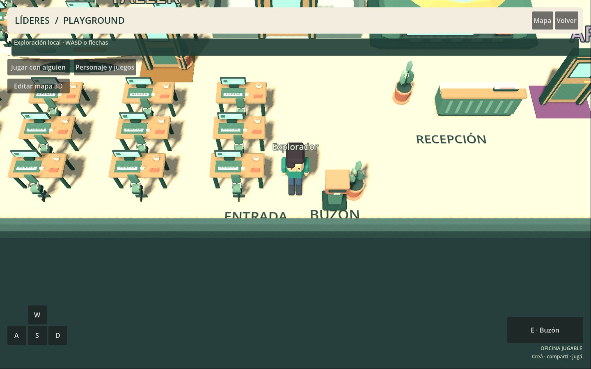

# Primer Videojuego Full IA — Oficina 3D

Oficina social en Godot: personajes personalizables, puertas al arcade y al taller,
seis minijuegos, creador de desafios y buzon de sugerencias. Backend multijugador Nakama.

[**Jugar la preview web**](https://games.lideres.pedrovallarino.com/)

## Empezar

1. Instala Godot **4.7.1** (edicion estandar).
2. Importa `game/project.godot` y ejecuta con **F5**.
3. Para probar las salas y guardar desafios, prepara un Nakama local siguiendo la
   [guia de contribucion](docs/CONTRIBUTING.md).

Blender **4.5.9** es opcional: los modelos GLB ya estan incluidos.
La preview web depende de un servidor de prueba; esta copia no incluye su configuracion.

## Editar y colaborar

- [Editar el mapa sin programar](docs/edit-map.md).
- [Fuentes Blender y exportacion](docs/art-office-3d.md).
- [Arquitectura y contrato de red](docs/architecture-3d.md).
- [Instalacion, pruebas y propuestas de cambio](docs/CONTRIBUTING.md).

El repositorio es publico. Los visitantes pueden abrir issues o proponer cambios mediante
pull requests. **Solo el propietario habilita colaboradores con permiso de escritura.**
La rama `main` exige revision del propietario para contribuciones de colaboradores.
El propietario conserva su capacidad de administracion.

No hay despliegue automatico a partir de propuestas externas. Usa datos y credenciales
locales de prueba; nunca publiques secretos, bases, archivos personales ni caches.

## Estado del juego

La oficina usa geometria3D y movimiento sobre el plano, con colisiones y reglas validadas
por Nakama. Los seis minijuegos mantienen interfaces2D. El editor permite cambiar piezas
localmente; el mapa compartido conserva su geometria canonica hasta revisar una nueva version.

## Procedencia y licencia

[Creditos de arte](art/ATTRIBUTIONS.md) y [procedencia del SDK](game/addons/PROVENANCE.md).
El SDK Nakama conserva su licencia Apache2.0. No se ha agregado una licencia general
al codigo y arte originales; la visibilidad publica no modifica las licencias de terceros.
